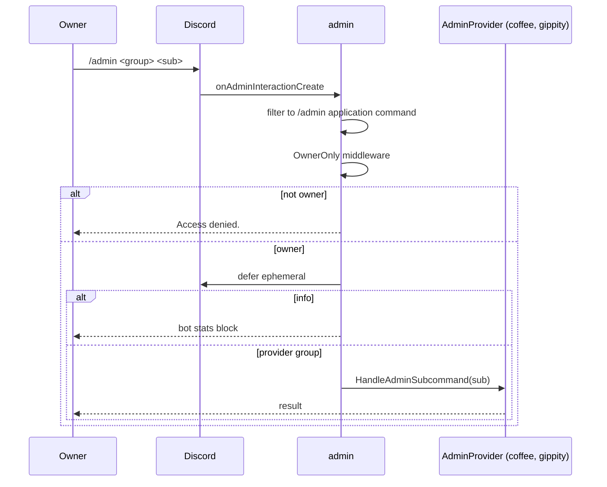

# admin

Directory `internal/admin`. Implements `bot.Module`; constructed with `admin.New(providers ...bot.AdminProvider)`.

Owner-only `/admin` command. The command tree is built from the injected `bot.AdminProvider` modules (coffee, gippity) plus the built-in `info` subcommand.

- Providers are passed to `admin.New` by the composition root (`internal/core/cmd.go`), including only modules whose `Init` succeeded.
- Adding a provider means passing it to `admin.New`; no edits inside `internal/admin` are required.
- `SetInfoText` injects the `/admin info` renderer, owned by the composition root because it aggregates the shared status snapshot.
- Owner authorization runs through the `bot.OwnerOnly` middleware; there is no inline owner check.
- All responses are ephemeral.

## Dispatch flow

