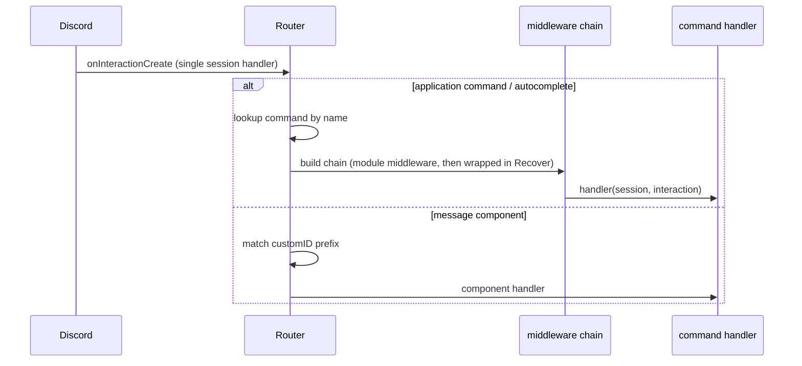
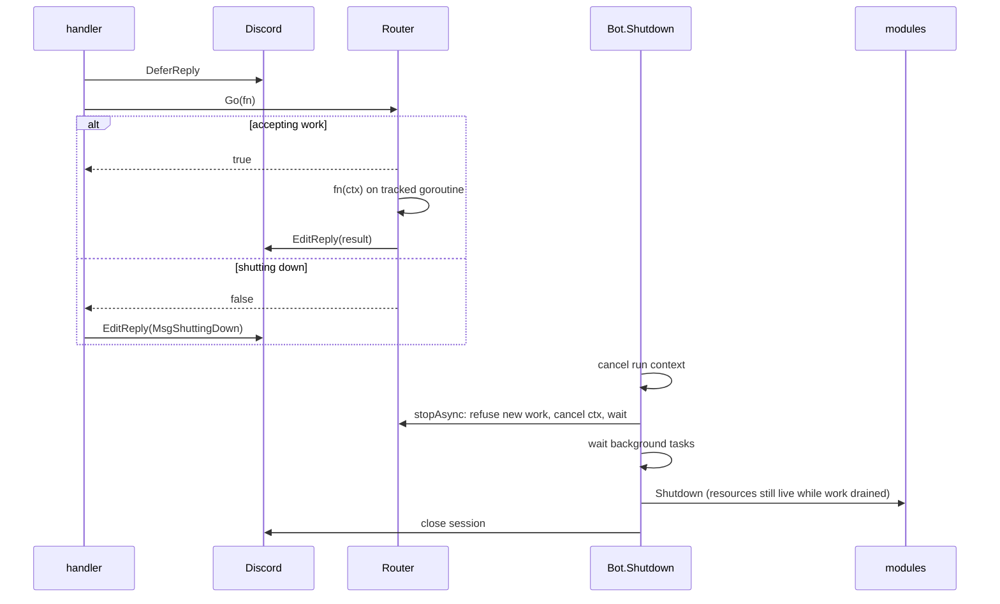

# bot

Directory `internal/bot`. Shared module framework. Not user-facing.

- `module.go` – `Module` interface (`Name`, `Init`, `Background`, `Shutdown`) and `AdminProvider`. A module registers every Discord handler through `Deps.Router` during `Init`; there are no `Commands`/`Listeners`/`Components` methods any more.
- `deps.go` – `Deps` (Session, Config, LLM `*llm.Client`, Logger, OwnerID, DB, Stats, Tools, Settings, Router).
- `router.go` – the single registration and dispatch point. Modules call `AddCommand(cmd, handler, mw...)`, `AddComponent(prefix, handler)`, `OnMessage(handler)` and the typed `OnReady`/`OnConnect`/`OnDisconnect`/`OnResumed`/`OnMessageUpdate`/`OnMessageReactionAdd`/`OnMessageReactionRemove`; the router installs exactly one `MessageCreate` and one `InteractionCreate` session handler. All `AddHandler` calls for those two events live here. The typed `On*` methods make a mistyped gateway listener a compile error, unlike discordgo's untyped `AddHandler`.
- `bot.go` – `Bot`: sets `Deps.Router`, registers modules (Init + stats), registers the router's commands with Discord, runs the background supervisor, and shuts down. Production boots through `bot.New(deps).Run(ctx)`.
- `reply.go` – deferred-reply helpers: `DeferReply(s, i, ephemeral)`, `DeferUpdate(s, i)`, `EditReply(s, i, edit)` (logs a failed edit; the caller owns the payload, including `AllowedMentions`), the shared `MsgShuttingDown` text, and `Router.Go(fn)`, which runs a deferred reply's slow work on a tracked goroutine (see "Deferred replies").
- `background.go` – `BackgroundSupervisor` runs panic-safe goroutines.
- `middleware.go` – `OwnerOnly` (its denial is autocomplete-aware, returning empty choices for an autocomplete interaction instead of a message) and `Recover`.
- `stats.go` – `StatsProvider`, `ModuleStats` and the `StatsRegistry` the core module reads for `/status`.
- `Deps.Tools` is the shared `*tool.Registry`; modules register LLM tools in `Init` and gippity reads it at answer time.
- `Deps.Settings` is the runtime settings store (`internal/settings`). A module reads its hot keys through it so `/admin config` applies without a restart, and falls back to its `Init`-time value when the store is nil (tests build `Deps` by hand).

## Interaction dispatch

Messages are dispatched the same way: one session `MessageCreate` handler fans out
to each module's `OnMessage` handler in its own goroutine, matching discordgo's
default `SyncEvents=false` behaviour. Command, component and message handlers all
run behind `Recover`.

`AddCommand` rejects a duplicate command name; `Bot.RegisterModule` turns that
into a registration failure for the offending module and rolls its
registrations back, so a collision is loud instead of silently dropping a
command (Discord's bulk overwrite fails the whole batch on one collision).
`Bot.RegisterModule` also snapshots the router before a module's `Init` and
rolls the registrations back if `Init` fails, so a broken module cannot leave
half its commands published.

`BackgroundSupervisor.Start` launches each task in a goroutine and recovers panics; `Wait` blocks until all return.

## Deferred replies

A handler whose work can exceed Discord's 3 s acknowledgement window defers
(`DeferReply`/`DeferUpdate`) and hands the slow part to `Router.Go`. `Go` runs fn
on a goroutine with a router-owned context, recovers panics, and tracks it in a
wait group; the context exists from `newRouter`, so handlers firing before `Run`
work. Once the bot is shutting down `Go` returns false without running fn and
the handler edits the reply to `MsgShuttingDown`. Modules must not start bare
goroutines for deferred replies. On a nil router (tests that skip `Init`) fn runs
inline with `context.Background()`.

