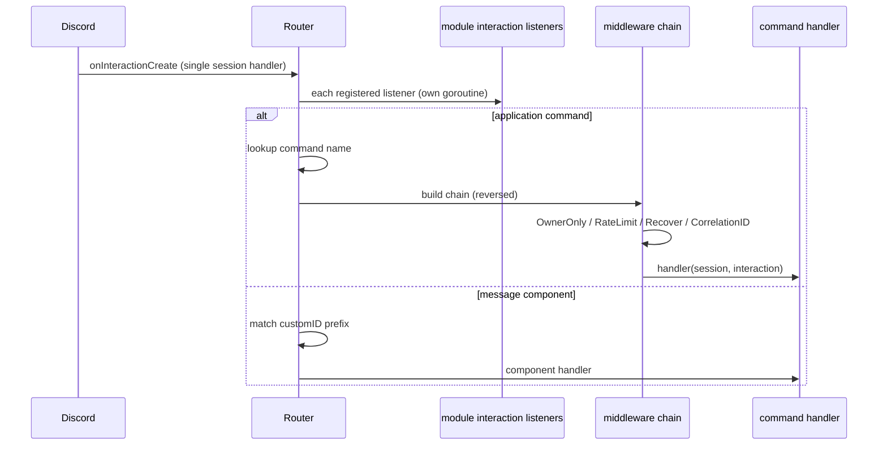

# bot

Directory `internal/bot`. Shared module framework. Not user-facing.

- `module.go` – `Module` interface (`Name`, `Init`, `Commands`, `Listeners`, `Components`, `Background`, `Shutdown`) and `AdminProvider`.
- `deps.go` – `Deps` (Session, Config, LLM `*llm.Client`, Logger, OwnerID, DB, Stats, Tools).
- `router.go` – the single `MessageCreate`/`InteractionCreate` session handlers; funnels module listeners into typed buckets and dispatches commands/components with middleware. All `AddHandler` calls live here.
- `bot.go` – `Bot`: registers modules (Init + listeners + commands + stats), publishes slash commands, runs the background supervisor, and shuts down. Production boots through `bot.New(deps).Run(ctx)`.
- `background.go` – `BackgroundSupervisor` runs panic-safe goroutines.
- `middleware.go` – `OwnerOnly`, `RateLimit`, `Recover`, `WithCorrelationID`.
- `stats.go` – `StatsProvider`, `ModuleStats` and the `StatsRegistry` the core module reads for `/status`.
- `Deps.Tools` is the shared `*tool.Registry`; modules register LLM tools in `Init` and gippity reads it at answer time.

## Interaction dispatch

Messages are dispatched the same way: one session `MessageCreate` handler fans out
to each module's message listener in its own goroutine, matching discordgo's
default `SyncEvents=false` behaviour.

`BackgroundSupervisor.Start` launches each task in a goroutine and recovers panics; `Wait` blocks until all return.
