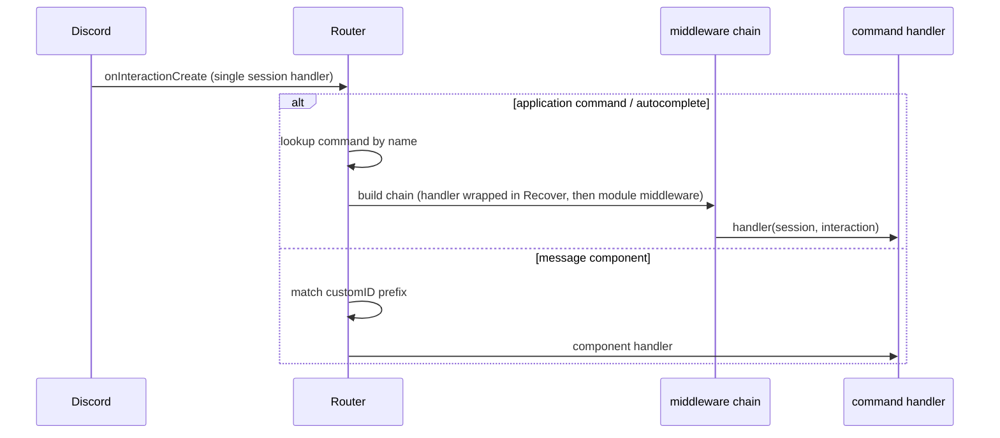

# bot

Directory `internal/bot`. Shared module framework. Not user-facing.

- `module.go` – `Module` interface (`Name`, `Init`, `Background`, `Shutdown`) and `AdminProvider`. A module registers every Discord handler through `Deps.Router` during `Init`; there are no `Commands`/`Listeners`/`Components` methods any more.
- `deps.go` – `Deps` (Session, Config, LLM `*llm.Client`, Logger, OwnerID, DB, Stats, Tools, Router).
- `router.go` – the single registration and dispatch point. Modules call `AddCommand(cmd, handler, mw...)`, `AddComponent(prefix, handler)`, `OnMessage(handler)` and the typed `OnReady`/`OnConnect`/`OnDisconnect`/`OnResumed`/`OnMessageUpdate`; the router installs exactly one `MessageCreate` and one `InteractionCreate` session handler. All `AddHandler` calls for those two events live here. The typed `On*` methods make a mistyped gateway listener a compile error, unlike discordgo's untyped `AddHandler`.
- `bot.go` – `Bot`: sets `Deps.Router`, registers modules (Init + stats), registers the router's commands with Discord, runs the background supervisor, and shuts down. Production boots through `bot.New(deps).Run(ctx)`.
- `background.go` – `BackgroundSupervisor` runs panic-safe goroutines.
- `middleware.go` – `OwnerOnly` and `Recover`.
- `stats.go` – `StatsProvider`, `ModuleStats` and the `StatsRegistry` the core module reads for `/status`.
- `Deps.Tools` is the shared `*tool.Registry`; modules register LLM tools in `Init` and gippity reads it at answer time.

## Interaction dispatch

Messages are dispatched the same way: one session `MessageCreate` handler fans out
to each module's `OnMessage` handler in its own goroutine, matching discordgo's
default `SyncEvents=false` behaviour.

`BackgroundSupervisor.Start` launches each task in a goroutine and recovers panics; `Wait` blocks until all return.
