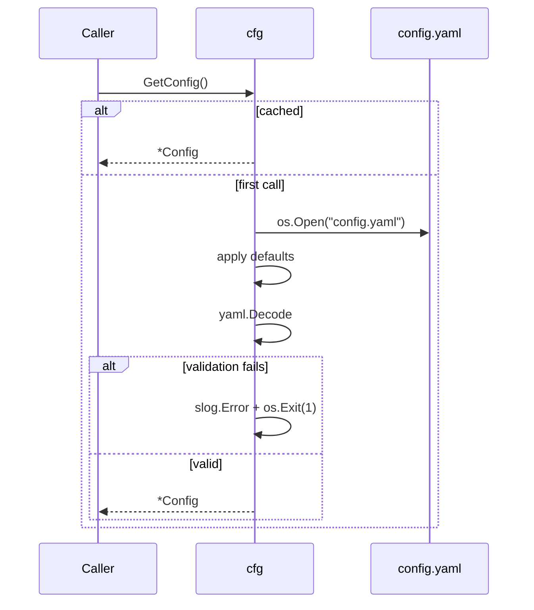

# cfg

Directory `internal/cfg`. YAML config load + validation.

- `GetConfig()` – lazy singleton, calls `loadFile()` once.
- `loadFile()` – opens `config.yaml`, exits process on error.
- `Decode(io.Reader)` – YAML decode + default application only, no validation.
- `Validate(*Config)` – required fields plus the positive-value and enum rules.
- `decodeConfig()` – `Decode` then `Validate`; the boot path's single call.

`Decode` and `Validate` are split so the runtime settings store
(`internal/settings`) can re-validate a merged config — the file plus every
stored `/admin config` override — with exactly the boot rules, instead of
growing a second set of rules. `Decode` never rejects a config: it is also used
to build the defaults-only baseline that tells a built-in default from an
explicit `config.yaml` value.

Required: `discord.token`, non-empty `gippity.allowed_guilds`. `web.session_secret` required when `web.port != 0`. Defaults: soundboard queue depth 6, gippity reply rate limit 30/h, gippity classifier rate limit 30/h, `llm.max_tokens` 300, gippity `reply_in_thread`/`respond_to_all_messages` false, gippity `classifier_names`/`debug_channel` empty (the classifier already knows the bot's own username and display name; an empty debug channel restricts nothing), gippity `tools.enabled` false, gippity `tools.max_iterations` 3.

Optional `web.eso` tunes the `/api/eso` guards (`rate_limit_burst` 5, `rate_limit_per_minute` 30, `max_concurrent_requests` 4, `request_timeout_seconds` 15). Nothing is validated: an omitted or non-positive key keeps the default, which the web server resolves in `resolveEsoLimits`.

## Load flow

