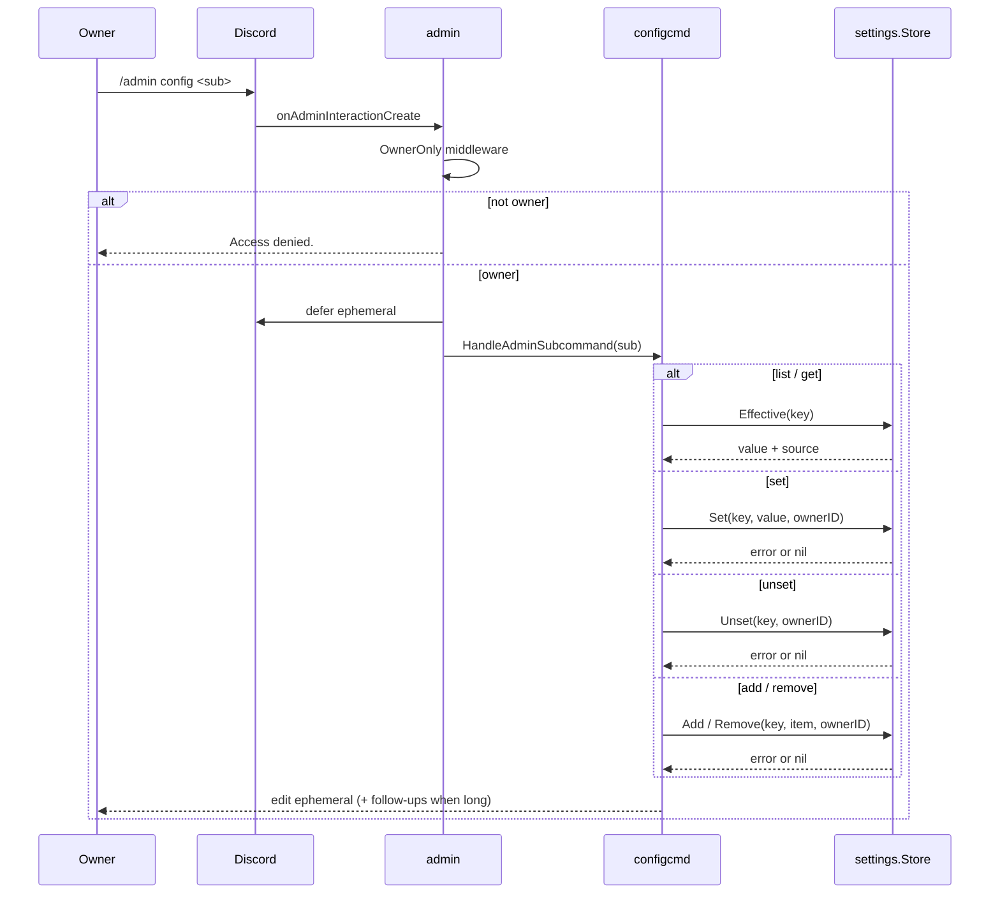
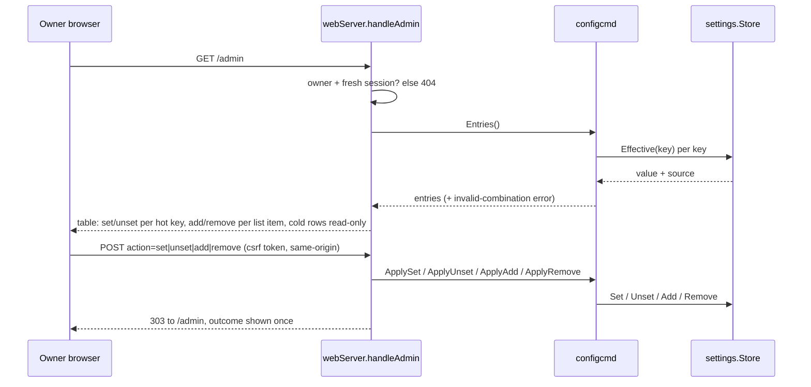

# configcmd

Directory `internal/configcmd`. Implements `bot.Module` and `bot.AdminProvider`
for the owner-only `/admin config` command. It is the only writer of the
`settings` table.

- `list` – every registered key with its effective value and source.
- `get <key>` – value, source and when it applies.
- `set <key> <value>` – validate, store the override, report the new effective
  value. A rejected value is reported with the reason and the unchanged current
  value.
- `unset <key>` – drop the override so `config.yaml` applies again.
- `add <key> <value>` / `remove <key> <value>` – add or drop one item of any
  list key (for example `gippity.allowed_guilds`). A duplicate add, a missing
  remove, a non-list key and removing the last allowed guild are rejected.

`list` shows the hot keys first (with any `Note` warning), then the cold keys in
a "Read-only (restart required: edit config.yaml)" section. `get` on a cold key
shows value, source and that note. Every write to a cold key is refused with a
"read-only at runtime" reply that names the value in force, so it reads
differently from an unknown key.

It registers no slash command of its own: the group lives under `/admin`, whose
`OwnerOnly` middleware is the access control, and the admin module already
defers the interaction ephemerally, so replies edit that response. Keeping it a
provider rather than a second top-level command also keeps global slash command
names unique.

Messages longer than Discord's per-message limit are split on line boundaries
and sent as ephemeral follow-ups, so a long `list` (a `classifier_names` value,
for example) is not truncated.

The effective value of `llm.model`, `llm.vision_model` and `llm.max_tokens` is
rendered through `Deps.LLM`, because their real fallback lives in the llm client:
an empty `llm.model` means the client's built-in default, an empty
`llm.vision_model` means "follow the text model", and `llm.max_tokens` is floored
by the client.

`llm.base_url` is cold but is redacted on every display surface (`list`, `get`,
refusals and `Entries` for the web panel): the userinfo, query and fragment are
masked (`https://***@host/path?***`) because a deployment may embed a credential
there; a value that does not parse as an absolute URL is masked whole. Credentials embedded in the URL path (for example `https://host/key/sk-.../v1`) are not redacted.

An unknown key and a secret key produce the same reply, so the command cannot be
used to probe for the existence of a credential.

The module also exposes that work as `Entries`, `ApplySet`, `ApplyUnset`,
`ApplyAdd` and `ApplyRemove`, and
the web admin panel (`/admin`, see `core`) calls these instead of duplicating the
validation, the secret-key hiding or the llm display special cases. `Entries`
returns the store's invalid-combination error alongside the entries, which is
what both surfaces report as `INVALID CONFIGURATION`; `UnavailableMessage` is the
one wording used for a missing store. `ApplySet` and `ApplyUnset` also report
whether the write happened, which the panel turns into the outcome banner.

## Dispatch flow

The web admin panel reaches the same methods, with its own access control: the
session must belong to `discord.owner_id` and be fresh (12h), every refusal is a
404, and a change is a POST carrying a per-session form token.

