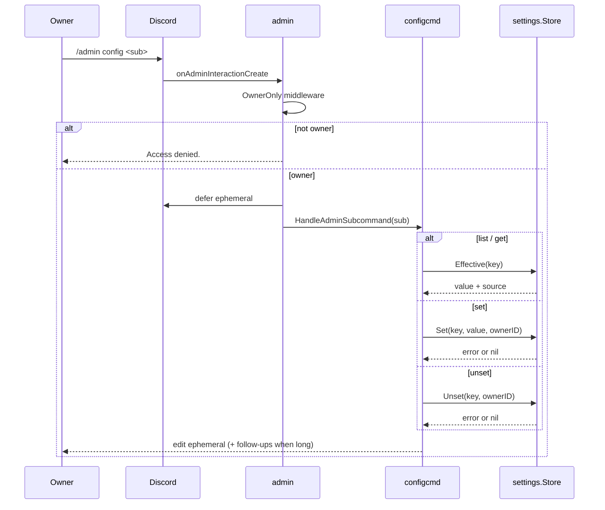

# configcmd

Directory `internal/configcmd`. Implements `bot.Module` and `bot.AdminProvider`
for the owner-only `/admin config` command. It is the only writer of the
`settings` table.

- `list` – every registered key with its effective value and source.
- `get <key>` – value, source and when it applies.
- `set <key> <value>` – validate, store the override, report the new effective
  value. A rejected value is reported with the reason and the unchanged current
  value.
- `unset <key>` – drop the override so `config.yaml` applies again.

It registers no slash command of its own: the group lives under `/admin`, whose
`OwnerOnly` middleware is the access control, and the admin module already
defers the interaction ephemerally, so replies edit that response. Keeping it a
provider rather than a second top-level command also keeps global slash command
names unique.

Messages longer than Discord's per-message limit are split on line boundaries
and sent as ephemeral follow-ups, so a long `list` (a `classifier_names` value,
for example) is not truncated.

The effective value of `llm.model`, `llm.vision_model` and `llm.max_tokens` is
rendered through `Deps.LLM`, because their real fallback lives in the llm client:
an empty `llm.model` means the client's built-in default, an empty
`llm.vision_model` means "follow the text model", and `llm.max_tokens` is floored
by the client.

An unknown key and a secret key produce the same reply, so the command cannot be
used to probe for the existence of a credential.

## Dispatch flow

