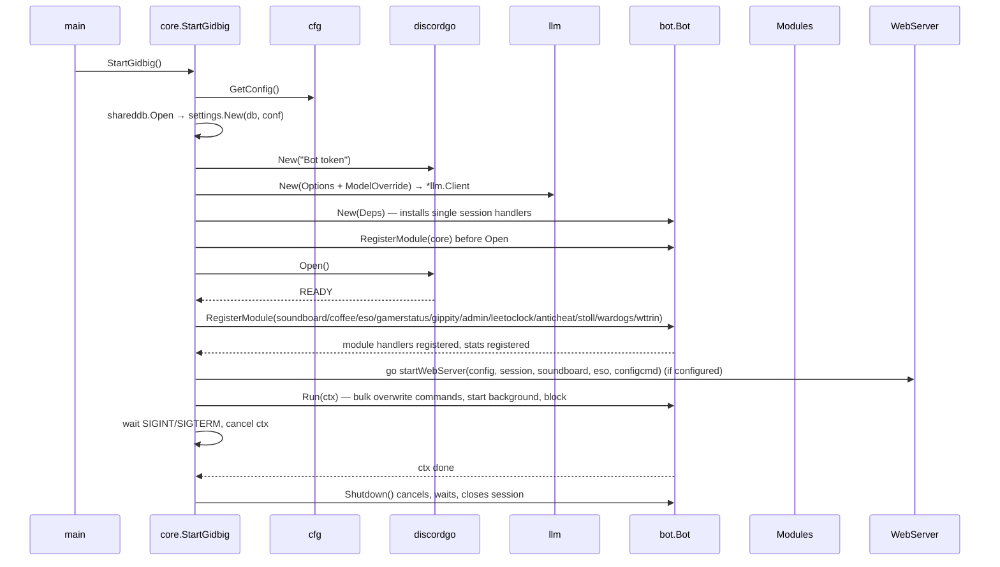
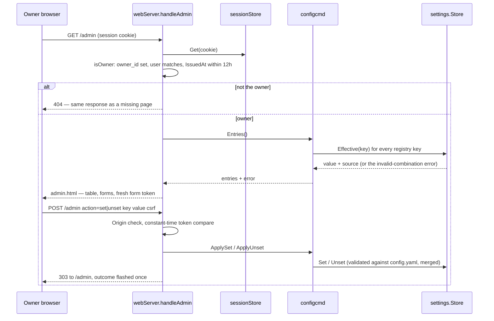

# core

Package `gidbig`, directory `internal/core`. Composition root and core module.

- `cmd.go` – `StartGidbig`: opens the shared database, builds the runtime settings store, builds the session and the `*llm.Client`, wires modules through `bot.Bot`, waits for signal, shuts down.
- `module.go` – the core `bot.Module`: lifecycle logging (`onReady`/`onConnect`/`onDisconnect`/`onResumed`), ping/pong, `/status`, `/uptime`.
- `tools.go` – registers the `bot_status` LLM tool, which reports the process runtime line (heap, sys, stack, goroutines, GC cycles, uptime) plus aggregated `StatsProvider` counters for the answer path.
- `slashcmd.go` – `/uptime` rendering helpers.
- `status.go` / `status_users.go` – `/status` snapshot collection and rendering. The snapshot carries an `LLM` section with the effective, non-secret LLM configuration (provider, models, base URL, credential source, persona source, classifier, reasoning effort, tools, rate limits, timeouts), sourced from the shared `*llm.Client` (`Info`) and the gippity config via `Module.llmStatus`.
- `webserver.go` – optional OAuth session web UI, sound + eso APIs.
- `webadmin.go` – the owner-only `/admin` panel: it renders the same runtime
  settings the `/admin config` command edits, through the `configcmd` module, and
  applies a set or an unset with the same validation. Access needs the session to
  belong to `discord.owner_id` and to have been issued within
  `adminMaxSessionAge` (12h); every refusal is a plain 404 so the panel cannot be
  discovered. A submission needs the per-session form token and a matching
  `Origin`, and is a POST that redirects back to the table.
- `ratelimit.go` – per-IP token bucket and global concurrency cap guarding the unauthenticated, token-billed `/api/eso`, tuned through the optional `web.eso` config (`resolveEsoLimits`).
- `wsdeadline.go` – read/write deadlines on discordgo websockets.
- `version.go`, `discordlog.go`, `structs.go`.

The soundboard lives in `internal/soundboard`; the web server reaches it through
the module's exported `Collections`, `Enqueue` and `QueueStatus` API.

## Startup sequence

`StartGidbig` builds the session and `Deps`, registers every module with a
`bot.Bot`, then calls `bot.Run(ctx)`. The Bot owns the single `MessageCreate` and
`InteractionCreate` session handlers, the background supervisor, and the
slash-command bulk overwrite; no other code calls `AddHandler`.

## Web admin panel

`/admin` is a second front end for the runtime settings the `/admin config`
command edits. Both call the same `configcmd` methods, so a value is validated
and applied identically whichever surface the owner uses; the panel adds no
writer of its own.

The session cookie carries the login time (`IssuedAt`, stamped in the OAuth
callback), the panel's form token and one flash message.

Each key is rendered with a control that fits its kind: a checkbox for a boolean
(Go's `PostFormValue` returns the first value of a repeated name, so the checkbox
comes before a hidden `false` fallback that covers the unticked case, which
submits nothing), a number field for an integer, a text field otherwise. The
checkbox is ticked from the effective value through the `isTrue` template helper,
so a row stored as `1` or `TRUE` shows as ticked too.

