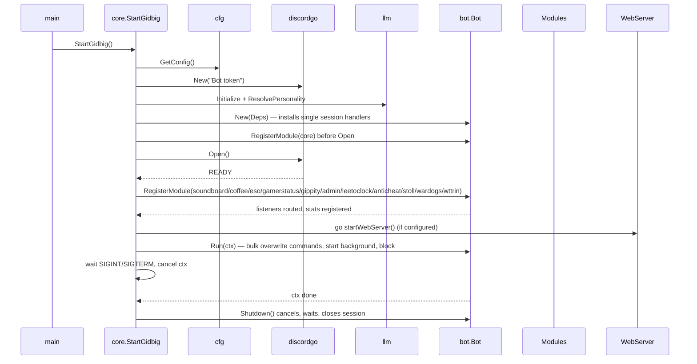

# core

Package `gidbig`, directory `internal/core`. Composition root and core module.

- `cmd.go` – `StartGidbig`: builds session, wires modules through `bot.Bot`, waits for signal, shuts down.
- `module.go` – the core `bot.Module`: lifecycle logging (`onReady`/`onConnect`/`onDisconnect`/`onResumed`), ping/pong, `/status`, `/uptime`.
- `slashcmd.go` – `/uptime` rendering helpers.
- `status.go` / `status_users.go` – `/status` snapshot collection and rendering.
- `webserver.go` – optional OAuth session web UI, sound + eso APIs.
- `wsdeadline.go` – read/write deadlines on discordgo websockets.
- `version.go`, `discordlog.go`, `structs.go`.

The soundboard lives in `internal/soundboard`; the web server reaches it through
the module's exported `Collections`, `Enqueue` and `QueueStatus` API.

## Startup sequence

`StartGidbig` builds the session and `Deps`, registers every module with a
`bot.Bot`, then calls `bot.Run(ctx)`. The Bot owns the single `MessageCreate` and
`InteractionCreate` session handlers, the background supervisor, and the
slash-command bulk overwrite; no other code calls `AddHandler`.

