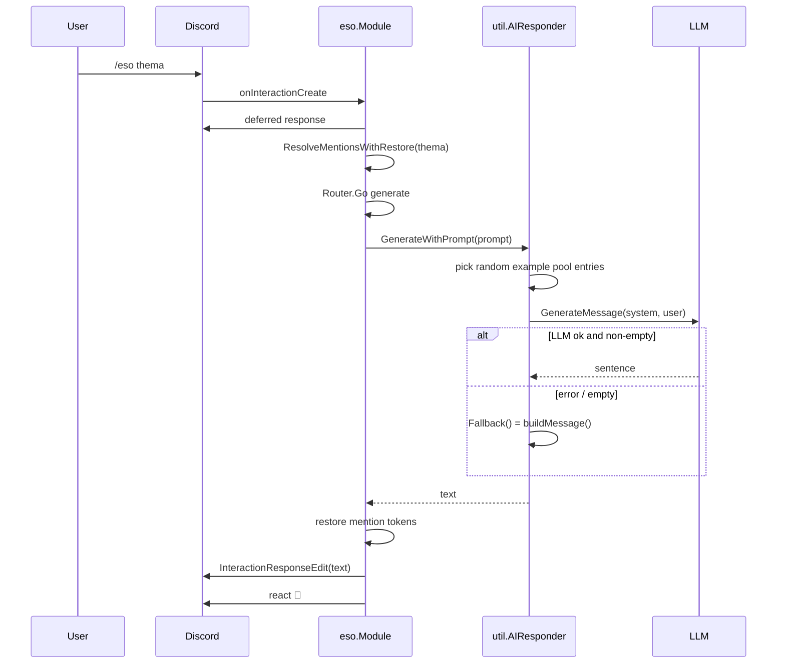

# eso

Directory `internal/eso`. Implements `bot.Module`.

Generates one sentence of esoteric German nonsense via LLM with few-shot examples. Falls back to a deterministic generator (`buildMessage`) when the LLM fails or returns empty.

- Command: `/eso [thema]`.
- Also exposed over HTTP: `GET/POST /api/eso` (web server), via `Module.GenerateText`.
- Core helper: `util.AIResponder`.

The endpoint is unauthenticated and each call bills LLM tokens, so the web server
guards it in `internal/core/ratelimit.go`: a per-IP token bucket (`429` +
`Retry-After` when empty), a global cap on concurrent generations (`503` when
saturated) and a per-request timeout that makes the responder fall back to
`buildMessage` instead of waiting on the provider. Defaults: burst 5, refill
30/min, 4 concurrent, 15s timeout, all overridable through the optional
`web.eso` config section.

## Command flow

