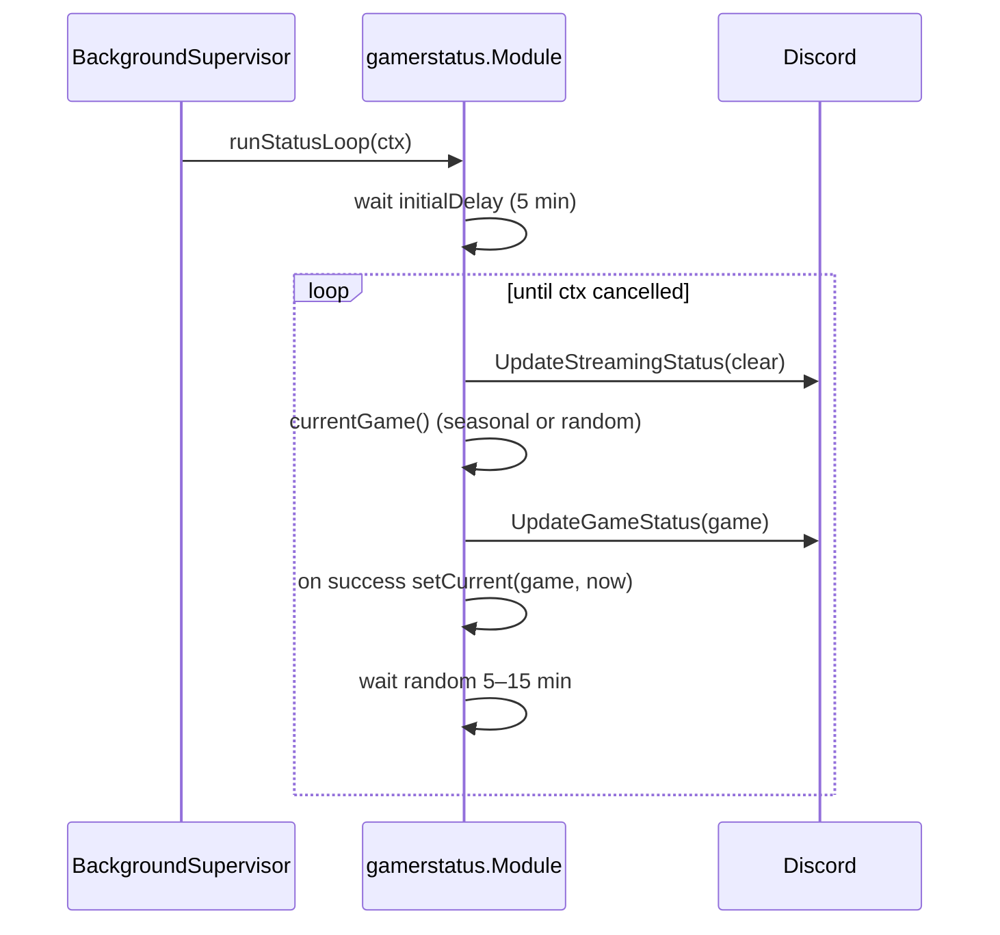

# gamerstatus

Directory `internal/gamerstatus`. Implements `bot.Module`.

Rotates the bot's "playing" status through a retro-game list. On seasonal dates (`util.Season`) shows a themed status instead. No commands.

After Discord accepts a status, the module stores the game and the time it was set (mutex-guarded, never held across the Discord call). The LLM tool `current_game_status` reports that game and how long ago it was set, or that no status is set yet (before the first rotation). Status changes by other code, such as the core ping/pong status, are not tracked.

## Background rotation

Seasonal overrides: Halloween, April Fools, New Year, Easter, Christmas; otherwise random game from `games`.
