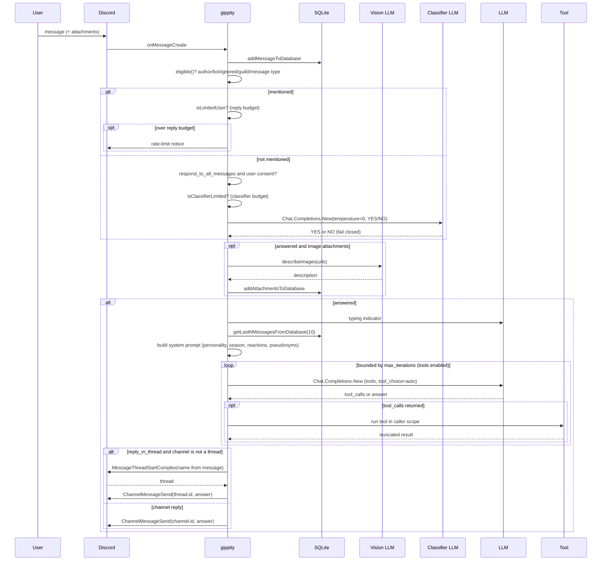

# gippity

Directory `internal/gippity`. Implements `bot.Module`, `bot.AdminProvider` and `bot.StatsProvider`; registered with `bot.Bot` in `core/cmd.go` (which calls `Init`).

LLM chat for Discord: answers when the bot is mentioned, keeps per-channel history, describes image attachments, honors per-user privacy, rate-limits mentions, and can optionally answer non-mention messages that the classifier accepts.

- Commands: `/gippity privacy set:on|off`, `/gippity nonmention set:on|off`.
- Storage: shared SQLite `gidbig.db`, prefixed tables (`gippity_chat_history`, `gippity_chat_history_edits`, `gippity_chat_attachments`, `gippity_user_privacy`, `gippity_user_consent`).
- Rate limit: `rate_limit_messages_per_hour` per user (reply budget). Non-mention classifier calls have a separate `classifier_rate_limit_per_hour` per-user budget.
- Reply target: `reply_in_thread` (default `false`) posts the answer inside a public thread started on the mentioning message instead of the channel. The thread name is derived from that message (mentions, backticks and control/format characters stripped, clamped to 100 characters). Messages that already arrive in a thread are answered in place, since Discord does not nest threads, and a failed thread start falls back to the channel. Rate-limit notices follow the same setting.
- Debug channel: `debug_channel` (default empty) restricts the bot to one channel while debug logging is enabled, so a debug run does not answer in every channel. Empty disables the restriction and the bot answers in all channels.
- Non-mention responses: `respond_to_all_messages` (default `false`) enables the classifier decision for messages that do not mention the bot. Each user must additionally opt in with `/gippity nonmention set:on` (`gippity_user_consent`, default off). Direct mentions always bypass the classifier and the consent check. The decision uses `classifier_model` (empty → `llm.model`) with `temperature=0` and a 5-token cap, parses a strict `YES`/`NO`, and fails closed on any provider or parsing error. Vision/attachment descriptions run only after a positive decision, and over-budget non-mentions are skipped silently. The classifier prompt names the bot, so a message that addresses it by name without a Discord mention (`gustaff, ...`) can be accepted; the names are the bot's own Discord username and display name plus any `classifier_names` aliases, and the model still decides per message.
- Tool calling: `gippity.tools` (see [tools](../tools.md)) optionally offers registered tools to the model and runs a bounded tool loop in `completeWithTools` (`gippity_tools.go`). `enabled` (default `false`) keeps the pre-tool single-call path; `max_iterations` (default 3) caps tool-call rounds before a final tool-free call; `allowed` optionally restricts tool names; `reasoning_effort` is sent only on tool-bearing requests and cleared for the final tool-free call (some providers forbid tools together with reasoning). The tool scope (`tool.Env{GuildID, ChannelID, UserID}`) is taken from the originating message, never from model arguments, and the whole loop is bounded by a 60s context deadline. gippity owns `search_chat_history` (scope-clamped channel/guild history search by keyword and/or an inclusive `from`/`to` `YYYY-MM-DD` date range, with prompt-path privacy parity) and `get_channel_members` (the members who can see the caller's channel; when the tool is offered the member list is dropped from the system prompt, and when it is not — tools disabled, no registry, or allowlisted out — the list stays in the prompt). The core module owns `bot_status`.

## Message answer flow

Edited messages update `chat_history_edits` (versioned). Message replies inject a system note with the referenced message content.
