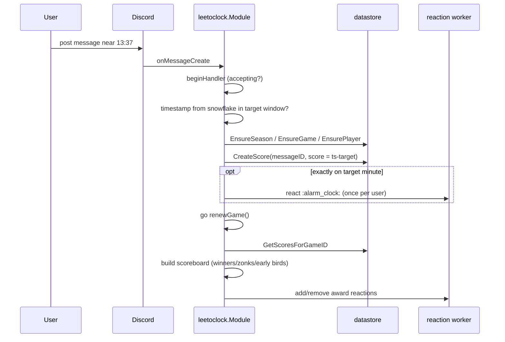

# leetoclock

Directory `internal/leetoclock`. Implements `bot.Module`.

Daily game: players race to post exactly when the clock hits `13:37` (configurable). Score = ms offset from target (can be negative). Keeps a scoreboard, reacts with award emojis, announces winners.

- Store: SQLite via `leetoclock/util/datastore`.
- Emojis: configurable guild IDs, else Unicode fallback.
- Debug mode: one minute after start, fast tick.
- LLM tool: `leetoclock_records` mirrors `/leetoclock top|daily|player`, scoped to the caller's guild. Subcommand `top` ranks the best distinct players over the window (one row per player, not per day); `daily` returns one winner per calendar day; `player` lists one player's best attempts. The `user` argument accepts an ID, name, nickname or mention; partial names resolve against the caller's guild via `util.ResolveMemberQuery`, and ambiguous names return a candidate list.
- Date lookup: pass `date:YYYY-MM-DD` (command option `date`, tool argument `date`) to query one game date. It overrides `period`, so a question about a named day cannot be answered with a neighbouring period's numbers.
- Date range: the tool's `from`/`to` arguments (`YYYY-MM-DD`, inclusive) query an arbitrary window that no `period` preset can express. Set either side alone for an open-ended window: `from` alone reaches to today, `to` alone reaches back to the earliest stored game. `date` and `from`/`to` are mutually exclusive.

## Record commands

- `/leetoclock top` shows this server's ten best distinct players for the current calendar month. Example: `/leetoclock top period:7d scope:global public:true` posts the last seven days' top players across all servers in the invoking channel.
- `/leetoclock daily` shows one winner per calendar day for the selected period. Example: `/leetoclock daily period:30d` lists the daily winners of the last 30 days.
- `/leetoclock player` shows your current-month records in this server, including valid attempt count and ten best scores. Example: `/leetoclock player user:@someone period:all` looks up that player's records in this server; `/leetoclock player period:all scope:global` shows your own records across servers without linking to other servers' messages. `scope:global` with `player` is only available for yourself, in the slash command and the LLM tool alike.

All three subcommands default to private (ephemeral) responses. Set `public:true` to share in the invoking channel. Set `scope:global` for cross-server records; otherwise results cover all channels in the current server. Global results show server names when available and never link to cross-server messages. Period choices: `month` (current calendar month), `today`, `yesterday`, `week` (current calendar week from Monday), `7d` (past 7 days), `30d` (past 30 days), `year` (current calendar year), `all` (all stored history). The `date` option queries a single day; the LLM tool also accepts `from`/`to` for an arbitrary day range. Only scores at or after the target time count; early-bird negative scores are excluded.

Public `/leetoclock top` uses plain display names, resolving uncached players through Discord; if lookup fails, it shows their user ID instead of hiding their identity. It never uses player mentions. Private results can display player mentions without sending notifications.

Older databases need a one-time repair before these commands can read historical game rows correctly. See [database repair instructions](../leetoclock-database-repair.md).

## Scoring flow

Background loops: `runPreparationLoop` announces the target time; `runWinnerLoop` posts the scoreboard after the round and resets state.
