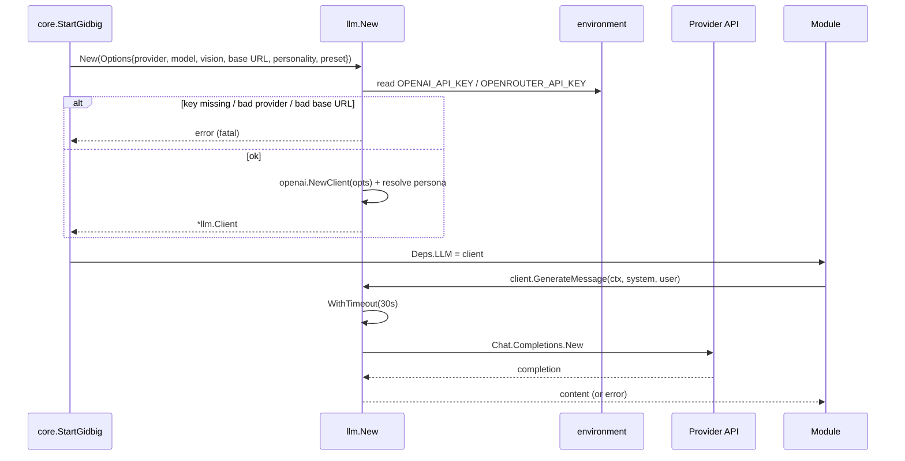

# llm

Directory `internal/llm`. Shared OpenAI-compatible client + persona, carried as
a `*llm.Client` through `bot.Deps.LLM`. Not user-facing.

- `New(Options)` – builds a `Client` from `provider` (`openai`/`openrouter`),
  reads `OPENAI_API_KEY`/`OPENROUTER_API_KEY`, sets base URL, timeout, models
  and resolves the persona. Returns an error on a bad provider, missing key or
  invalid base URL.
- `Client.GenerateMessage` – single-turn completion, 30s timeout, 150 max tokens.
- `Client.DetectChannelLanguage` – LLM language detect over last 20 channel
  messages, 1h cache held on the client.
- `Client.Personality` – custom string > preset (`hal`, `schemer`, `dry`,
  `genalpha`) > built-in default (resolved once in `New`).
- `Client.Model`, `Client.VisionModel`, `Client.GetClient` – resolved
  configuration and the raw client for direct calls (gippity).
- `CompletionContent` – pure helper that returns the first choice or an error.

There is no package-level mutable state: all of it lives on the `Client`, so
modules can be constructed and tested without a global.

## Client init + generation

