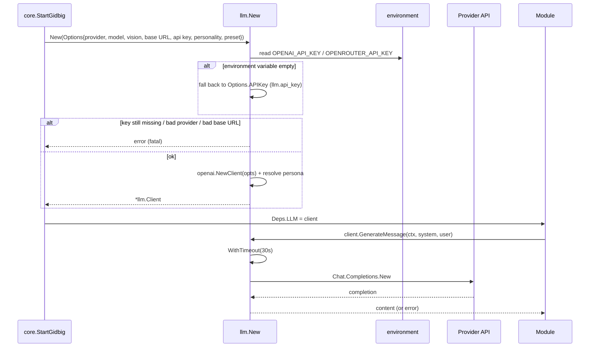

# llm

Directory `internal/llm`. Shared OpenAI-compatible client + persona, carried as
a `*llm.Client` through `bot.Deps.LLM`. Not user-facing.

- `New(Options)` – builds a `Client` from `provider` (`openai`/`openrouter`),
  reads the API key from `OPENAI_API_KEY`/`OPENROUTER_API_KEY` and falls back to
  `llm.api_key` when the environment variable is unset, sets base URL, timeout,
  models and resolves the persona. Returns an error on a bad provider, missing
  key or invalid base URL.
- `Client.GenerateMessage` – single-turn completion, 30s timeout, 150 max tokens.
- `Client.DetectChannelLanguage` – LLM language detect over last 20 channel
  messages, 1h cache held on the client.
- `Client.Personality` – custom string > preset (`hal`, `schemer`, `dry`,
  `genalpha`) > built-in default (resolved once in `New`).
- `Client.Model`, `Client.VisionModel`, `Client.GetClient` – effective
  configuration and the raw client for direct calls (gippity). `Model` and
  `VisionModel` resolve `Options.ModelOverride`/`VisionModelOverride` on every
  call, so `/admin config set llm.model` applies to the next request without a
  restart; with no resolver (or an empty value) the boot-time model is kept.
  When `llm.vision_model` was not set at boot, `VisionModel` follows the
  effective text model, including a runtime change to it.
- `Client.Info` – resolved, non-secret configuration for status output
  (provider, models, base URL, credential *source*, persona *source*, timeout,
  max tokens). It never returns the API key or the persona text. The models
  reported are the effective ones, so a runtime `llm.model` override shows up
  here too.
- `CompletionContent` – pure helper that returns the first choice or an error.

There is no package-level mutable state: all of it lives on the `Client`, so
modules can be constructed and tested without a global.

## Client init + generation

