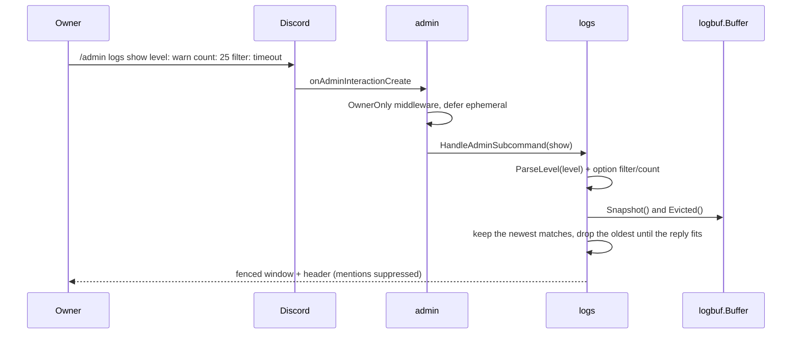
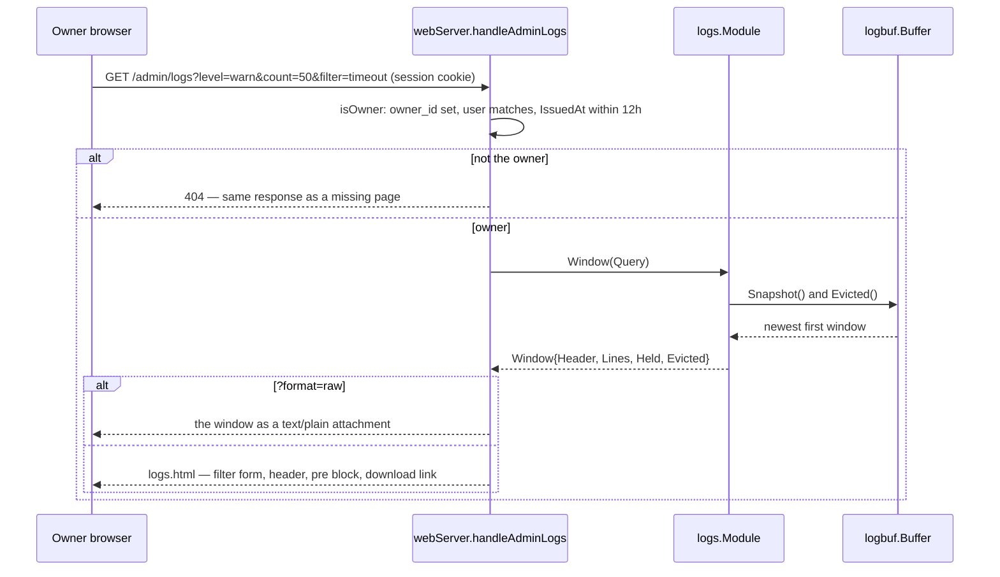

# logs

Package `logs`, directory `internal/logs`. Implements `bot.Module` and
`bot.AdminProvider`; constructed with `logs.New(buf *logbuf.Buffer)`.

Reads the bot's own recent log lines out of the in-memory window
(`internal/logbuf`) the process logs through, so what the process wrote to its
log can be inspected without shell access to the container:

- Discord: the owner-only `/admin logs show` command, replied ephemerally.
- Web: the owner-only page `/admin/logs`, with the same filter form and a
  `text/plain` download of the shown window.

Both surfaces call the module's `Window` method and render its `Header`/`Text`,
so the command and the page cannot describe the same window differently.

## What is captured

- `internal/core/cmd.go:setupLogging` builds the buffer (`logbuf.New`, 500 lines)
  and wraps the process handler — text in dev mode, JSON otherwise — in
  `logbuf.NewHandler`, which stores every accepted record and forwards it.
  Because the wrapper sits on the standard logger, every `slog` call in every
  module, the gateway diagnostics (`discordlog.go`) included, is captured, and
  because it wraps rather than replaces the handler, `Enabled` still decides
  through the process level: a hot `dev_mode` change reaches the window too.
  The handler format itself stays boot-time (`dev_mode` at startup).
- A stored line is already flat: `time LEVEL message key=value (file.go:line)`.
  Newlines and tabs are escaped, control characters dropped, the message and the
  attribute text are capped at 600 runes and a single attribute value at 160, so
  one record is always one bounded line.
- The ring keeps the newest N lines; once it is full the oldest line is dropped
  and counted (`Evicted`), which the header reports so an operator can tell
  "nothing logged" from "the window no longer reaches that far back".
- There is nothing to configure: the module owns no setting. The window holds
  what the handler accepted, so the level stays the process level and the format
  stays boot-time.

Each view of the page and each `/admin logs` call logs its own `WebUI Request`
line into the window the command logs through, because every route does. That is
expected: the request log is part of what the bot logs.

The window holds exactly what the process logs — nothing is redacted on the way
in, and dev mode (debug level, prompt content) therefore reaches the owner too.
Both surfaces are owner-only for that reason: the access control is the point,
not the filtering.

## Gates and bounds

- The command inherits `/admin`'s `OwnerOnly` middleware and the admin module's
  ephemeral deferral; the page reuses the panel's `isOwner` check (owner ID
  match plus a login no older than `adminMaxSessionAge`) and answers every
  refusal with the 404 of a missing page.
- The window is bounded by `MaxShowLines` (100) and the filter by
  `MaxFilterRunes` (100); `Query.normalize` applies both, so neither surface can
  ask for more than the other. The Discord option and the panel select are built
  from the same `LevelOptions` vocabulary.
- The reply is one message: `DiscordContent` drops the oldest matching lines
  until the fenced block fits `discordContentRunes` (1900) and says how many were
  left out — a wide window never becomes a trail of follow-up messages. The
  full window stays available on the page.
- The reply is one fenced code block with backticks defused, and the edit
  carries `util.NoMentions()` (`"parse":[]`), so a log line cannot ping or turn
  into markup.
- The page renders the window through `html/template`, and the download is sent
  as an attachment with `nosniff`.

## Reading the window (Discord)

## Reading the window (web)

