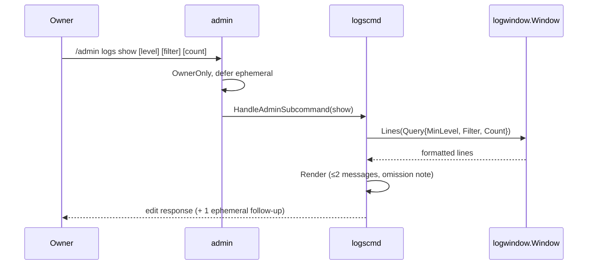

# logscmd

Directory `internal/logscmd`. Implements `bot.Module` and `bot.AdminProvider`
for the owner-only `/admin logs show` command over the in-memory log window
(`logwindow`). It registers no slash command of its own: the group lives under
`/admin`, whose `OwnerOnly` middleware is the access control, and the admin
module already defers the reply ephemerally.

Options:

- `level` – `debug`/`info`/`warn`/`error`, default `info`.
- `filter` – case-insensitive substring, default none.
- `count` – 1–200 newest lines, default 50.

`Render` packs the newest matching lines into at most two ephemeral messages
(each a code block of at most 1900 runes). When older lines do not fit, the
first message starts with `… N older lines omitted — see /admin/logs`. Lines are
joined exactly as the `/admin/logs` download joins them; the only differences
are that a line containing a triple backtick gets a zero-width space so it
cannot close the code block, and a single line longer than one message is
truncated with `…`. No match replies `No matching log lines.`

`StartGidbig` registers the module and appends it to the `admin.New` providers;
both are needed for the group to appear.

## Dispatch flow

