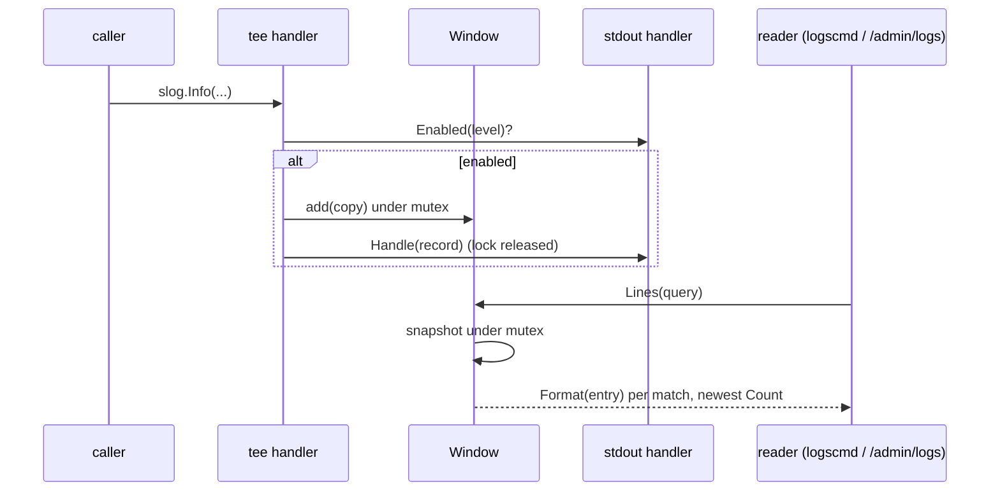

# logwindow

Directory `internal/logwindow`. In-memory window of the most recent log records,
read by `/admin logs show` (`logscmd`) and the owner-only `/admin/logs` web page
(`core`). Nothing is written to disk; the window is gone on restart.

- `New(capacity)` – fixed-capacity ring (`DefaultCapacity` 2000 when capacity is
  not positive), guarded by a `sync.Mutex`.
- `Window.Handler(inner)` – a `slog.Handler` tee. `Enabled` delegates to `inner`,
  so the window holds exactly what the configured level (the process
  `slog.LevelVar`, including a hot `dev_mode` flip) accepts. `Handle` copies the
  record (time, level, message, attributes flattened with `WithAttrs` /
  `WithGroup` prefixes), appends it under the lock, releases the lock, then calls
  `inner.Handle`.
- `Window.Lines(Query{MinLevel, Filter, Count})` – rendered lines, oldest to
  newest: level floor, case-insensitive substring filter over the rendered line,
  then the newest `Count` (zero = whole window).
- `Format(Entry)` – the one line renderer both surfaces use:
  `2006-01-02T15:04:05Z LEVEL msg key=value ...` in UTC; values containing
  whitespace, `"` or `=` are quoted. Independent of stdout's text/JSON choice.
- `ParseLevel` – `debug`/`info`/`warn`/`error`.

The window is built in `core.setupLogging`, sized by `logs.window_lines`.

## Flow

