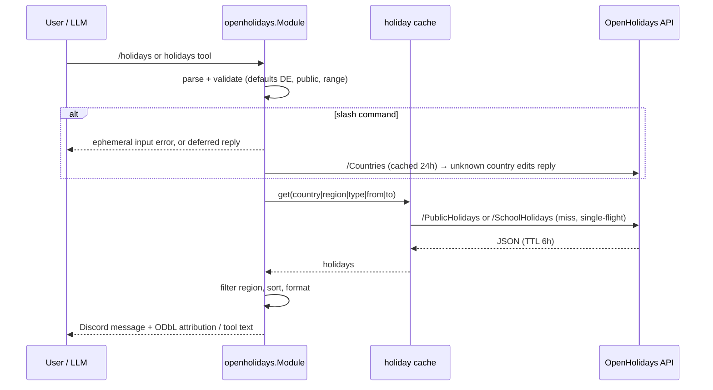

# openholidays

Directory `internal/openholidays`. Implements `bot.Module` and `bot.StatsProvider`.

Command `/holidays [country] [region] [type] [from] [to]` and the LLM tool `holidays`, both backed by the [OpenHolidays API](https://openholidaysapi.org). No API key and no config. `/holidays` posts publicly; every reply ends with the attribution line `Data: OpenHolidays API (ODbL)` (the data is licensed under ODbL).

- Defaults: country `DE`, type `public`, range today (Europe/Berlin) → today + 12 months − 1 day (tool: today → today + 30 days).
- `region` is a subdivision code such as `DE-NW`; when `country` is omitted it is taken from the region prefix. Nationwide holidays are always kept; regional ones are kept when they match the region or one of its children.
- Validation: `YYYY-MM-DD` dates, `to` ≥ `from`, range under 3 years, 2-letter country, region of the chosen country, type `public`/`school`. Input errors get an ephemeral reply. After the deferred response, the country is checked against the cached `/Countries` list (skipped when the list cannot be loaded); an unknown country edits the public reply.
- Autocomplete: `country` from `/Countries`, `region` from `/Subdivisions` (flattened) for the chosen or default country. Prefix match on code, name or short name, max 25 choices, 2 s budget, empty list on error.
- Names: German, else English, else the first available.
- Cache: holiday lists 6 h TTL keyed by `country|region|type|from|to`; countries and subdivisions 24 h. Single-flight, max 256 entries, errors not cached. Fetches run under the module context, which `Shutdown` cancels; `/holidays` replies run through `Router.Go`, which the bot drains before module shutdown.
- Fetch: `GET /PublicHolidays` or `/SchoolHolidays` with `countryIsoCode`, `validFrom`, `validTo`, optional `subdivisionCode`; 15 s timeout, 1 MiB body cap, non-200 is an error carrying the ProblemDetails `title`/`detail`.
- Output: H2 heading (`🎉 Public holidays DE-NW · 2026-10-25 → 2027-10-24`), one line per holiday in a code block (`Fri 2026-12-25  1. Weihnachtstag`, ranges as `start → end (N days)`, regional tags in parentheses), capped at 2000 characters with `…and N more`.
- LLM tool `holidays`: arguments `country`, `subdivision`, `type`, `from`, `to`. Plain-text lines with ISO dates, weekday, name, nationwide/regions and type. Bad arguments and API failures are tool errors.
- Stats: holiday lookups, cache size, hits, misses, metadata lookups, API errors, in flight.

## Holidays flow

