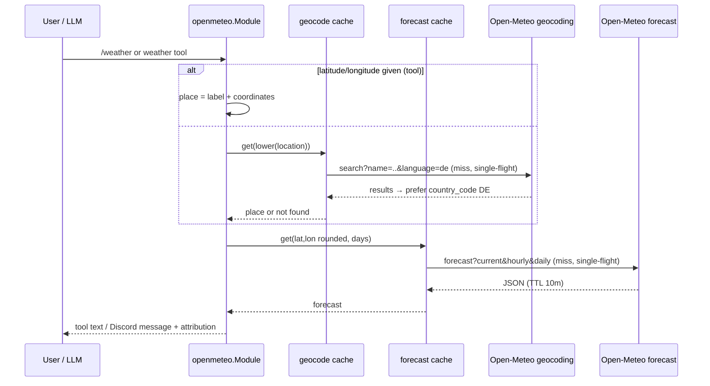

# openmeteo

Directory `internal/openmeteo`. Implements `bot.Module` and `bot.StatsProvider`.

Command `/weather location:<name> [forecast:<bool>] [days:<1-16>]` and the LLM tool `weather`, both backed by [Open-Meteo](https://open-meteo.com). No API key and no config. `/weather` posts publicly without an LLM outro; every reply ends with the attribution line `Daten: Open-Meteo.com (CC BY 4.0)`. Open-Meteo's free API is licensed for non-commercial use.

- Geocoding: `geocoding-api.open-meteo.com/v1/search` with `count=10&language=de`; the first `country_code=DE` result wins, otherwise the first result. The resolved place (name, admin1, country) is always shown. No results → `Ort nicht gefunden` (slash) or `no location found for "<loc>"` (tool string).
- Forecast: one `api.open-meteo.com/v1/forecast` request with `timezone=auto`, `forecast_days=N`, `current`, `hourly` and `daily` variables (daily precipitation sum, max precipitation probability, sunshine duration, dominant wind direction, gusts, UV, sunrise/sunset).
- Days: 1–16, default 7; out-of-range values are clamped. Current conditions fetch one day.
- Cache: forecasts 10 min TTL keyed by `lat,lon` rounded to 2 decimals + days; geocodes 24 h TTL. Both single-flight, max 256 entries (expired entries swept when full; errors not cached).
- Fetch: shared single-flight fetches run under the module context (cancelled by `Shutdown`, which also waits for pending `/weather` replies), not the first caller's; 15 s HTTP timeout, non-200 is an error, bodies capped at 1 MiB.
- `/weather` with an empty or overlong location gets an ephemeral hint.
- `/weather` output: current conditions + today, or one block per day (no hourly breakdown); truncated after the last complete day with `… (gekürzt)` to stay within 2000 characters.

## LLM tool `weather`

Arguments: `location` (required, ≤100 characters), optional `latitude`/`longitude` (both or neither; then `location` is only a label and geocoding is skipped), `days`, `forecast`. Plain-text output: location line, current conditions, one line per day, and a 3-hour breakdown (8 slots, precipitation summed over the slot, max probability) for days 1–3. Without `forecast` only today is listed. Open-Meteo failures return an error; there is no wttr.in fallback.

## Weather flow

