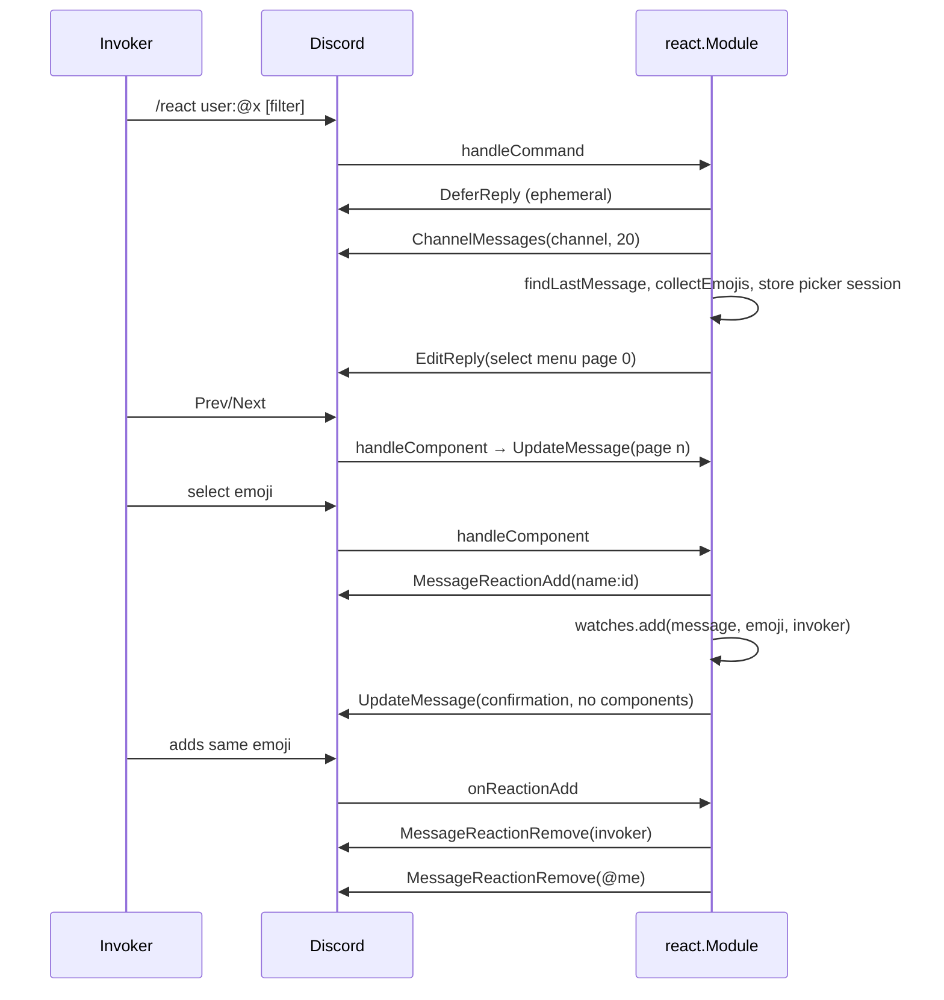

# react

Directory `internal/react`. Implements `bot.Module` and `bot.StatsProvider`.

`/react` lets anyone pick a custom emoji from an ephemeral, paginated select
menu. The bot reacts to the target message with it and, from then on, removes
the invoker's own reaction with that emoji on that message, and withdraws its
own reaction with it. The watch stays, so later re-adds by the invoker are
removed too. Other users' reactions are left alone.

- Command: `/react` with exactly one of `user` (that user's newest message among
  the last 20 in the channel) or `message_id` (must be in the current channel),
  plus optional `filter` (case-insensitive emoji name substring). All replies are
  ephemeral.
- Emojis: every available custom emoji in the gateway state cache across the
  bot's guilds, deduplicated by ID, sorted by name; 25 per page with Prev/Next.
- Picker sessions: in memory, keyed by a random 8-byte hex token in the custom
  IDs (`react:sel:<tok>`, `react:prev|next:<tok>:<page>`), 15 min TTL, swept by
  the `react-session-sweeper` background task. Only the invoker may use them.
- Watches: in memory (lost on restart), at most 1000, oldest evicted first. A
  watch is added only after the bot's own reaction succeeds.
- Permissions: Add Reactions, Read Message History; Manage Messages for removal
  (a failure is logged as a warning).
- Stats: `react_watches`, `react_removed`.

## Flow

