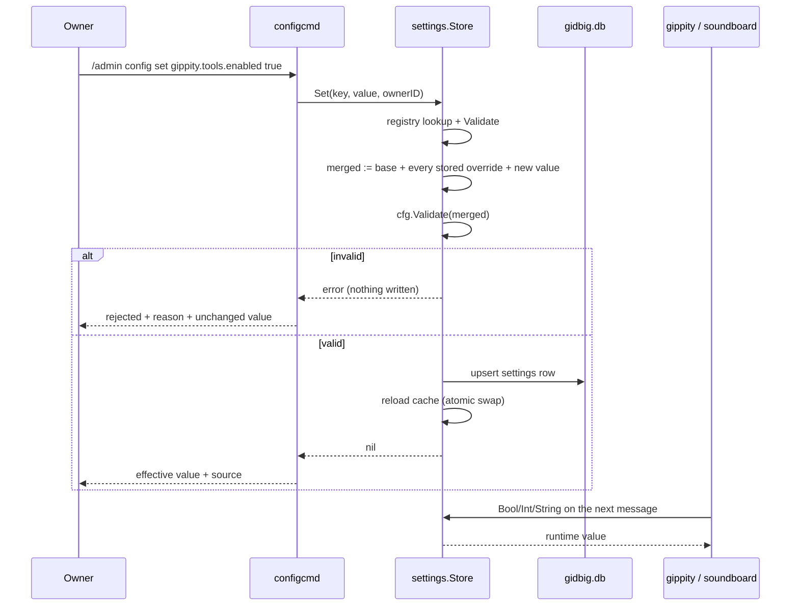

# settings

Directory `internal/settings`. Runtime overrides for operational settings,
persisted in the shared database and changed by the owner through `/admin
config`. Not user-facing on its own.

## What it does

- `New(db, base)` – creates the `settings` table if missing, loads every stored
  row into an in-memory cache and returns a `*Store`. `base` is the config
  loaded at boot; it supplies the values an override layers over. The shared
  `*gorm.DB` is owned by the composition root and is never closed here.
- `Store.Set/Unset` – validate, write, reload the cache.
- `Store.Bool/Int/String/StringList` – typed effective value for a key.
- `Store.Override` – the stored value only, without the config.yaml or built-in
  fallback. The llm client uses it to resolve `llm.model` per request.
- `Store.Effective` – `(value, source)` where source is `default`, `yaml` or
  `db`.
- `Keys()`/`Lookup()` – package-level accessors for the registry of runtime-editable keys.

## Precedence

```
built-in default  <  config.yaml  <  database override
```

An explicit `/admin config set` is operator intent, so the database row wins
over the file; the file stays the deploy-time seed. Removing the row with
`/admin config unset` falls back to the file. The bot never writes
`config.yaml`.

The source is derived without duplicating the default constants: `New` also
decodes an empty document, which applies only the built-in defaults, and a value
equal to that baseline is reported as `default`. One consequence is pinned by
test: a config.yaml value that happens to equal the built-in default is reported
as `default`, because the effective value is identical either way.

## Only hot keys are registered

Every registered key applies to the next read; there is no restart-required key
in the registry. A boot-time-only setting (for example `discord.shard_id`,
`web.port` or `dev_mode`) is therefore indistinguishable from a typo: both are
reported as an unknown key. Secrets are never registered, and every entry point
(`Lookup`, `Set`, `Unset`, `Effective`, `Override`) rejects a key flagged
`Secret`, so a future addition cannot leak a credential even by mistake.

## Registry, validation and keys

`registry.go` holds the key table: name, kind, `Extract` (read the deploy-time
value from a `*cfg.Config`), `Apply` (write a raw string into a config copy) and
an optional `Validate` for a rule `cfg.Validate` does not cover.

`Set` reuses the boot validation instead of growing a second set of rules: it
builds a copy of the base config, applies **every** stored override, then the
new value, and runs `cfg.Validate` on the result. Applying all overrides first
matters — two values that are individually valid can be invalid together (tools
enabled plus a zero iteration cap), and the file alone would not catch that.

Six keys carry a registry-local rule. Five of them restate a `cfg.Validate` rule — the four positive-value caps and the `reasoning_effort` enum — so the store can judge a single stored row on its own without building a merged config on every read:

- `llm.model` must not be empty; an empty model would mean the built-in default
  (or be invalid for openrouter), so `unset` is the way back.
- `gippity.classifier_rate_limit_per_hour` must be greater than zero. `cfg.Decode`
  applies the 30/h default for this key (matching the module's own fallback), so
  the owner sees the effective limit rather than a zero that would reject every
  classifier call.
- `llm.max_tokens` must be greater than zero. `cfg.Decode` applies the 300
  default, matching `llm.DefaultMaxTokens`, so the cap cannot be driven to zero
  (which would disable completions) from Discord.

## Cache

The cache is derived, never authoritative. `Set` order is validate → database
commit → reload cache, so a crash between the write and the swap only costs
staleness until the next reload or restart. The cache is published with an
`atomic.Pointer` to an immutable map: reads are lock-free (hot answer paths pay
almost nothing) and a writer swaps the whole snapshot rather than mutating it.
The mutex is held across the validation, the SQLite write and the cache reload, so two concurrent writes cannot each validate the pre-change state. It is never held across a Discord or other network call.

A stored value that does not parse (for example a row edited by hand with
`sqlite3`) is logged and falls back to the `config.yaml` value, so a bad row
cannot break an answer path. `Effective` and the typed getters share one rule: a stored
row is used only when it is *applicable* — it parses for the key's kind and passes
the key's own rule — so a row advertised with source `db` is always the value a
consumer receives. One unusable row also cannot block writes to other keys: `Set`
logs and skips it while validating, and `unset` clears it.

## Key flow


