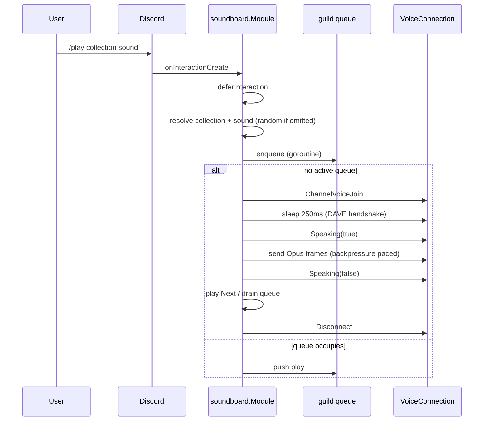

# soundboard

Directory `internal/soundboard`. Implements `bot.Module` and `bot.StatsProvider`.

Scans `audio/*.dca` into per-prefix collections and plays them in voice channels, one queue per guild.

- Commands: `/list`, `/play collection [sound]`.
- Lifecycle: `Init` loads the `.dca` files and applies `soundboard.queue_max_depth`; `Shutdown` has nothing to release (voice connections close when a queue drains).
- Queue depth: read through `Deps.Settings` at enqueue time (`queueMaxDepth`), so `/admin config set soundboard.queue_max_depth` applies without a restart. A per-guild queue channel is created once, with the depth in force at that moment, and survives until the queue drains, so a runtime change applies in full only to the next queue: the admission check is the smaller of the runtime depth and the channel's existing capacity. `offer` therefore never blocks — a raised depth cannot grow an existing channel, and a blocking send would hold the queue mutex that the player goroutine needs before it can drain, deadlocking both. `Init` still applies `soundboard.queue_max_depth` as the fallback when no store is wired.
- Exported API for the web server: `Collections()`, `Enqueue(user, guild, command, soundname)`, `QueueStatus()`.
- Stats: sound/collection/queue counters in `/status`.
- LLM tool: `list_sounds` lists the collections and their sound names.

## Playback flow

