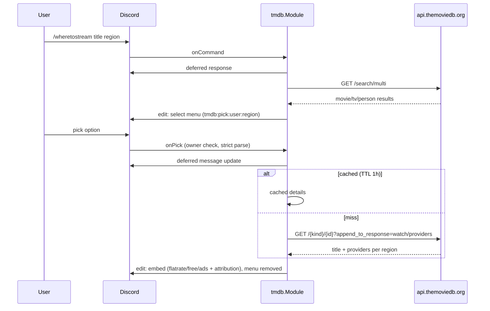

# tmdb

Directory `internal/tmdb`. Implements `bot.Module`. Optional: `internal/core`
registers it only when `tmdb.read_access_token` is set (`registerTMDB`);
otherwise it logs `tmdb: no read_access_token, module disabled` and there is no
command and no tool. A token change needs a restart.

Command `/wheretostream title:<text> [region:XX]` finds where a movie or series
streams. The reply is public.

- Auth: TMDB **API Read Access Token** as `Authorization: Bearer …`. The short
  "API Key" is not used. The token is never logged, never put in a URL and not
  exposed through `/admin config`.
- Search: `GET /3/search/multi` (`include_adult=false`); persons are dropped.
  Up to 25 matches become a select menu with custom ID
  `tmdb:pick:<userID>:<region>` and values `movie:<id>` / `tv:<id>`. Both are
  parsed strictly. Only the invoking user may pick; others get an ephemeral
  refusal.
- Pick: `GET /3/{movie|tv}/{id}?append_to_response=watch/providers` returns title
  and every region's providers in one call. Cached in memory for 1 h per
  `kind:id:language`; no lock is held across HTTP calls. No database use.
- Reply: one embed linking the TMDB watch page. Fields "Streaming (Abo)",
  "Kostenlos", "Mit Werbung" (flatrate, free, ads) sorted by
  `display_priority`; rent and buy are hidden. Missing region or no streaming
  offer gets an explanatory description.
- Attribution (required by TMDB terms): footer "Data by JustWatch via TMDB · This
  product uses the TMDB API but is not endorsed or certified by TMDB."
- Region / language: hot settings `tmdb.region` (default `DE`) and
  `tmdb.language` (default `de-DE`); the `region` option overrides per call.
- Errors: 429 maps to "TMDB rate limited, try again shortly", others to a generic
  retry hint. Lookups run in goroutines bound to a 15 s timeout and cancelled on
  `Shutdown`.
- LLM tool `streaming_providers(title, type?, year?, region?)`: without `type` it
  uses `/search/multi`, with `type` it uses `/search/movie` (`year`) or
  `/search/tv` (`first_air_date_year`). It takes the top match and returns
  plain text naming the match, providers, link and attribution.

## Command flow

