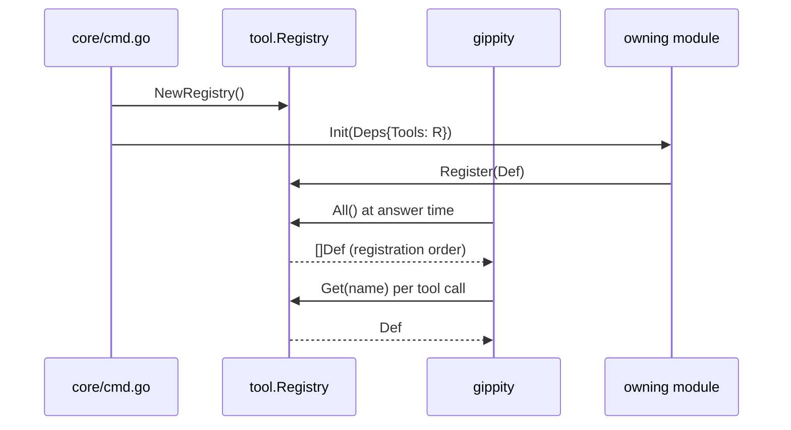

# tool

Directory `internal/tool`. Leaf package; imports only the standard library.

Provider-agnostic registry of LLM tools. A `Def` is a name, a description, a
JSON Schema for the arguments (`json.RawMessage`), and a `Handler` that receives
a caller scope (`Env`: guild/channel/user) plus raw JSON arguments and returns
one formatted string.

`Registry` is shared and mutable after construction: modules register during
`Init` and the gippity answer loop reads `All()` at request time, so
registration order does not matter. Re-registering a name replaces it in place.
`internal/core/cmd.go` creates the single registry and passes it in
`bot.Deps.Tools`. See [Adding an LLM tool](../tools.md).

## Registration and use

