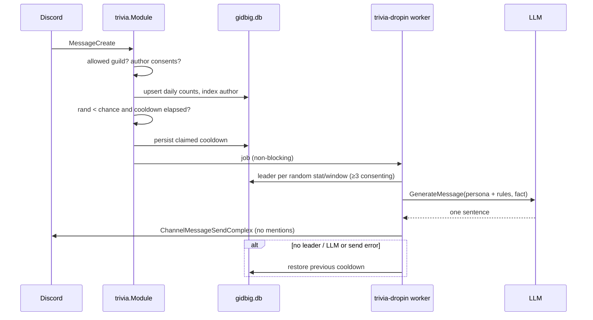

# trivia

Directory `internal/trivia`. Implements `bot.Module` and `bot.StatsProvider`.

Counts per-user chat activity in `gippity.allowed_guilds` and now and then posts
an LLM-phrased trivia line about one leader. No slash command.

- Consent: a user is counted, and may be named, only while their
  `/gippity privacy` is off (`gippity.Module.PrivacyEnabled`, injected by
  `cmd.go`; without gippity nobody is counted). Turning privacy back on stops
  counting and hides the user from drop-ins; stored rows are kept.
- Stats: `messages`, `words` (URLs excluded), `gifs`, `pictures`, `links`,
  `reactions_given`, `reactions_received`. GIF/picture/link are exclusive: each
  attachment, content URL or embed counts once (`classify.go`). Tenor/Giphy
  hosts, `.gif` and `gifv` embeds are GIFs; `image/*` attachments are pictures.
- Reactions: add +1, remove −1 (floored at 0). Given counts for a consenting
  reactor; received counts for the consenting author found in the 30-day
  message-author index. Bots and self-reactions (received) are skipped.
- Windows: all-time and the last 30 UTC days (daily buckets).
- Storage (shared `gidbig.db`): `trivia_daily_counts` (guild, user, day, stat,
  count), `trivia_message_authors` (pruned after 30 days by the `trivia-prune`
  task), `trivia_guild_state` (persisted drop-in cooldown).
- Drop-ins: each counted message rolls `trivia.dropin_chance` (default 0.01);
  outside the per-guild `trivia.dropin_cooldown` (default 24h) the cooldown is
  claimed and a job is queued (buffer 1, dropped and released when full). The
  `trivia-dropin` worker picks a random stat/window with at least 3 consenting
  participants, asks the LLM for one sentence, and posts it with no allowed
  mentions. On no eligible stat, LLM or send failure the cooldown is released.
- Needs the privileged Message Content intent (see [core](core.md)).
- `/status` counters: events counted, drop-ins, drop-ins skipped.

## Drop-in flow

