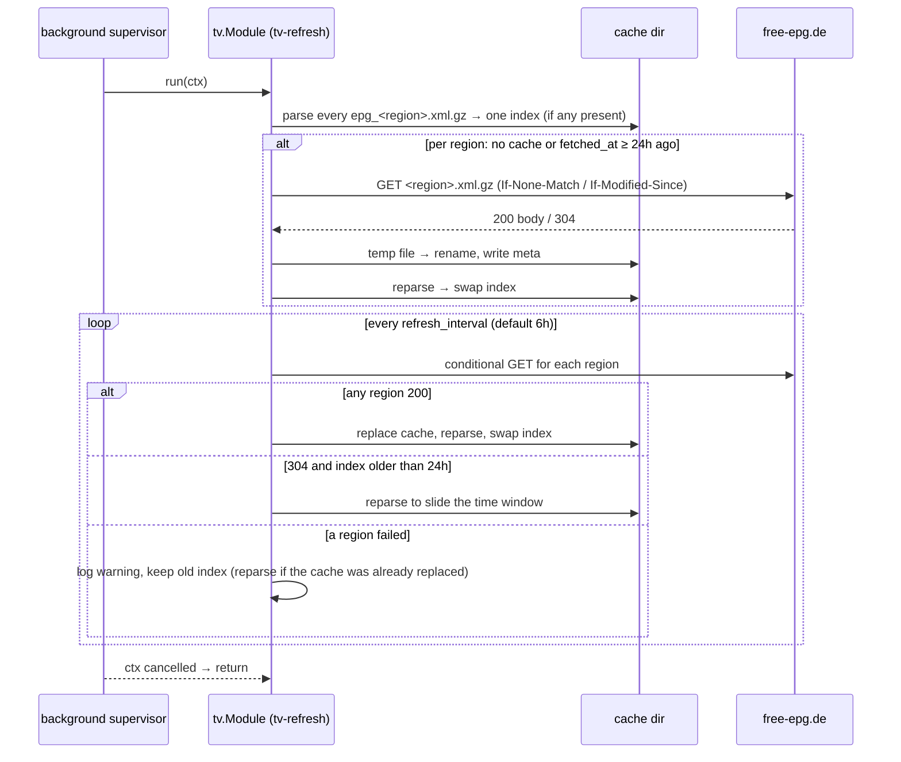

# tv

Directory `internal/tv`. Implements `bot.Module` and `bot.StatsProvider`.

Optional TV program from the [free-epg.de](https://free-epg.de) XMLTV country feeds (`https://www.free-epg.de/api/epg/<region>.xml.gz`). `tv.regions` selects the feeds (default `[de]`); several regions are merged into one index. `tv.timezone` (default `Europe/Berlin`) sets the displayed times and day boundaries. Off unless `tv.enabled: true`; a disabled module registers no command, no tool and no background task.

Slash replies are short on purpose, so a channel is not flooded:

- Every reply is **ephemeral** unless the user passes `public:true`. A public reply carries `SUPPRESS_NOTIFICATIONS` and no mentions. Errors and the not-ready notice are always ephemeral.
- No reply spans more than **6 hours**; `hours` (choices 1, 3, 6; default 6) narrows it.
- Times are Discord timestamps (`<t:unix:t>`, `<t:unix:f>`), so each reader sees their own local time. A `-# Data: free-epg.de …` footer ends every listing.
- A listing shows at most 20 shows (search: 10) and ends with `-# +N more` (search: `-# more results`) when cut; feed text is markdown-escaped; the footer always survives the 2000-character cap.

Subcommands:

- `/tv now [channel] [hours] [public]`: without a channel, one line per configured channel (the one view not capped at 20 lines; only the 2000-character limit applies, then `-# +N more`): `**ZDF** Running title → <t> Next title` (titles shortened to 40/28 runes). With a channel, the shows from now on for `hours`; the one already running is marked `▶`.
- `/tv channel <channel> [day] [from] [hours] [public]`: `day` is a choice `today` (default), `tomorrow`, `in 2 days` … `in 7 days`; `from` is a choice `now` (default), `06:00`, `12:00`, `18:00`, `20:15 (prime time)`, `22:00` in `tv.timezone`. `from:now` on a day other than today starts at 20:15.
- `/tv search <title> [public]`: up to 10 upcoming shows whose title or subtitle contains the query (case-insensitive, umlauts folded: `muenchen` = `München`), as `<t:f> · **Channel** · Title *Category*`.
- `channel` options autocomplete from the indexed channels (router forwards autocomplete interactions to the command handler). Names resolve through folded aliases: ID, ID without its region suffix (`.de`, `.at`, …), display name without its `XX - ` country prefix, plus built-ins like `ARD`, `ZDFneo`, `Pro7`, `RTL2`, `ntv`. Unknown names get a "Did you mean" hint.

Window line format (`/tv now channel:ZDF hours:3`):

```
📺 **ZDF** · <t:…:f> – <t:…:t>
▶ <t:…:t> **Der Quiz-Champion** *Show*
<t:…:t> **heute journal** *Nachrichten*
-# Data: free-epg.de · times in your local time zone
```

## Channels

Built-in list (`defaultChannels`, IDs verified 2026-10-24): Das Erste, ZDF, ZDFneo, ZDFinfo, 3sat, ARTE, phoenix, tagesschau24, ONE, KiKA, WDR, NDR, BR, RTL, RTLZWEI, SAT.1, ProSieben, ProSieben MAXX, VOX, Kabel Eins, NITRO, sixx, Super RTL, DMAX, Tele 5, n-tv, WELT. `tv.channels` replaces the list and is required (config validation) once `tv.regions` holds anything other than `de`, since the built-in list and aliases are German. An allowlisted channel without programmes logs a warning at each index build.

## Cache and index

- `<cache_dir>/epg_<region>.xml.gz` (default `cache/`) holds each region's feed gzip-compressed. The download sends `Accept-Encoding: gzip` so the transport keeps the body compressed; a plain body is compressed while writing. Writes go to a temp file and are renamed over the cache; the body is capped at 64 MiB; timeout 2 min.
- `<cache_dir>/epg_<region>.meta.json` stores `etag`, `last_modified` and `fetched_at` for conditional GETs.
- The index is built by a streaming `encoding/xml` parse that skips non-allowlisted elements. It keeps programmes ending after the start of yesterday in `tv.timezone` and starting before now+9 days (one spare day for an index up to 24 h old), fills a missing `stop` from the next start (placeholders included), then drops `No Data`/`Sendepause`/`Sendeschluss` rows, strips HTML and truncates descriptions to 200 runes. Times without an offset are UTC. Since the 2026-10-25 DST switch the feed labels some channels' UTC wall-clock times with the German offset, so they show one hour early. Per channel, if at least three rows in the kept window start at 19:15 German time and more than twice as many as at 20:15 (German prime time), every row of that channel moves one hour later and a `tv: channel clock is shifted, correcting` warning is logged. Stale rows outside the window do not vote. Channels without a clear 20:15 pattern (for example Kabel Eins, NITRO) are not corrected. Recheck at the 2027-03-28 DST switch: if the feed bug persists, summer rows may be two hours off. The full feed (~160k programmes) parses in well under a second into a few thousand indexed programmes.
- The index is immutable and swapped through an `atomic.Pointer`; readers never lock. Before the first build, commands and the tool answer "TV-Programm wird noch geladen…".

## LLM tool `tv_program`

Arguments: `mode` (`now`, `channel`, `search`, `listings`), `channel`, `day` (`today`/`heute`, `tomorrow`/`morgen`, `übermorgen`, `yesterday`/`gestern` or `YYYY-MM-DD`), `query`, plus the `listings` arguments below. Unlike the slash command it returns plain text with fixed times in `tv.timezone` (Discord timestamps mean nothing to the model) and may list a whole day; `now` for ≤10 channels and `search` with ≤10 hits include descriptions. Fixable input problems return a text hint, invalid JSON an error.

Horizons: `channel` accepts yesterday to +7 days; `search` and `listings` reach as far ahead as the index (about 7 to 9 days). `search` matches titles and subtitles only; a miss says so and points to `listings`.

`listings` answers aggregate questions such as "Krimis between 20:00 and 23:00 on ARD and ZDF this week":

- `category`: folded substring matched against **any** of a programme's genres. The parser keeps every `<category>` value (empty ones dropped); listings show them joined with `, `.
- `from` / `to`: `HH:MM` in `tv.timezone`, start inclusive, end exclusive; `to <= from` wraps past midnight. Defaults are the whole day. Slot membership uses the programme's **start** time.
- `channels`: array of names; omitted or `["all"]` means every channel. The first unknown name returns the usual "Unknown channel" hint.
- `days`: 1 to 7 calendar days starting today (default 7). Programmes that already ended are skipped.
- `offset`: first result to show (default 0).
- At least one of `category`, `from`, `to` is required, so the whole EPG is never dumped.

Rows look like `**ZDF** Sat 2026-10-24 20:15 Der Alte (Krimi, Thriller)`, ordered by start time, then channel order. A page fills rows up to 1900 runes (below the 2000-rune tool result cap, so no row is cut) and ends with `+N more, use offset=K`. Empty results are distinct: a category no programme has (the feed carries only genres such as Drama, Krimi, Action, Komödie, Horror, Abenteuer, Thriller and **no film or format field**, so "Spielfilm" never matches), nothing in the slot/days/channels, or an offset past the end.

## Stats

Summary: `channels`, `programmes`. Detail: `regions`, `timezone`, `index built`, `last fetch`, `last fetch status` (`<region>:200|304|error` per region fetched), `fetch errors`.

## Refresh flow



All `tv.*` keys are registered as cold settings: `/admin config` and the web settings panel list them read-only, and a change needs a restart.
