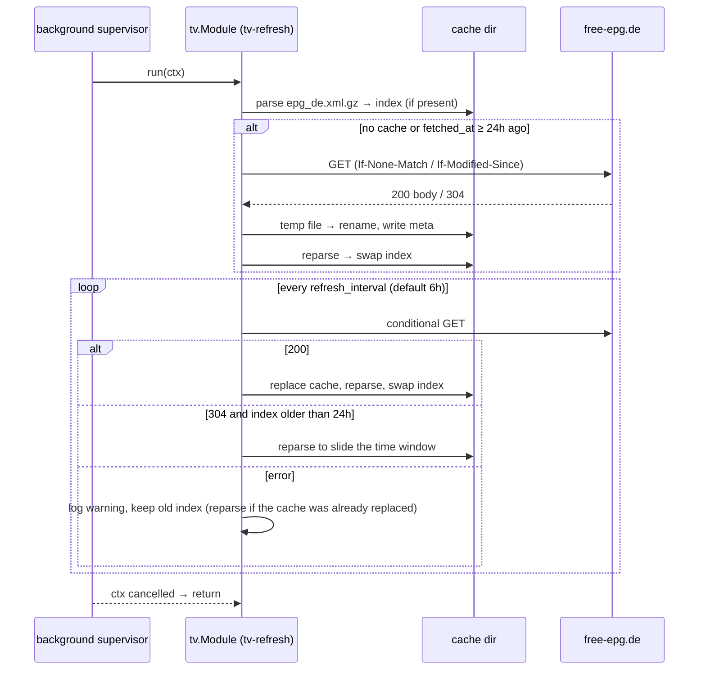

# tv

Directory `internal/tv`. Implements `bot.Module` and `bot.StatsProvider`.

Optional German TV program from the [free-epg.de](https://free-epg.de) XMLTV feed (`https://www.free-epg.de/api/epg/de.xml.gz`). Off unless `tv.enabled: true`; a disabled module registers no command, no tool and no background task. Replies are public; errors and the not-ready notice are ephemeral.

- `/tv now [channel]` — running and next show. Without a channel every configured channel gets one compact line (start + title).
- `/tv channel <channel> [day]` — a channel's schedule for one Europe/Berlin day. `day` is `heute` (default), `morgen`, `übermorgen`, `gestern` or `YYYY-MM-DD`, from yesterday to +7 days.
- `/tv search <title>` — up to 15 upcoming shows whose title or subtitle contains the query (case-insensitive, umlauts folded: `muenchen` = `München`).
- `channel` options autocomplete from the indexed channels (router forwards autocomplete interactions to the command handler). Names resolve through folded aliases: ID, ID without `.de`, display name, plus built-ins like `ARD`, `ZDFneo`, `Pro7`, `RTL2`, `ntv`. Unknown names get a "Meintest du" hint.
- Replies are capped below Discord's 2000-character limit; trailing lines become `…`.

## Channels

Built-in list (`defaultChannels`, IDs verified 2026-10-24): Das Erste, ZDF, ZDFneo, ZDFinfo, 3sat, ARTE, phoenix, tagesschau24, ONE, KiKA, WDR, NDR, BR, RTL, RTLZWEI, SAT.1, ProSieben, ProSieben MAXX, VOX, Kabel Eins, NITRO, sixx, Super RTL, DMAX, Tele 5, n-tv, WELT. `tv.channels` replaces the list. An allowlisted channel without programmes logs a warning at each index build.

## Cache and index

- `<cache_dir>/epg_de.xml.gz` (default `cache/`) holds the feed gzip-compressed. The download sends `Accept-Encoding: gzip` so the transport keeps the body compressed; a plain body is compressed while writing. Writes go to a temp file and are renamed over the cache; the body is capped at 64 MiB; timeout 2 min.
- `<cache_dir>/epg_de.meta.json` stores `etag`, `last_modified` and `fetched_at` for conditional GETs.
- The index is built by a streaming `encoding/xml` parse that skips non-allowlisted elements. It keeps programmes ending after the start of yesterday (Europe/Berlin) and starting before now+9 days (one spare day for an index up to 24 h old), fills a missing `stop` from the next start (placeholders included), then drops `No Data`/`Sendepause`/`Sendeschluss` rows, strips HTML and truncates descriptions to 200 runes. Times without an offset are UTC. The full feed (~160k programmes) parses in well under a second into a few thousand indexed programmes.
- The index is immutable and swapped through an `atomic.Pointer`; readers never lock. Before the first build, commands and the tool answer "TV-Programm wird noch geladen…".

## LLM tool `tv_program`

Arguments: `mode` (`now`, `channel`, `search`), `channel`, `day`, `query`. Returns the same text as the slash command; `now` for ≤10 channels and `search` with ≤10 hits include descriptions. Fixable input problems return a text hint, invalid JSON an error.

## Stats

Summary: `channels`, `programmes`. Detail: `index built`, `last fetch`, `last fetch status` (`200`, `304`, `error`), `fetch errors`.

## Refresh flow

All `tv.*` keys are registered as cold settings: `/admin config` and the web settings panel list them read-only, and a change needs a restart.
