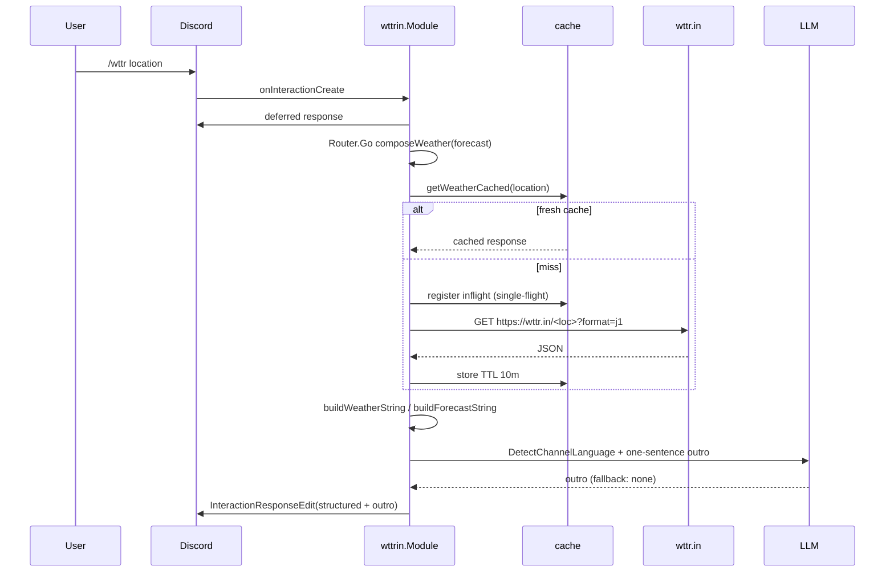

# wttrin

Directory `internal/wttrin`. Implements `bot.Module`.

Commands `/wttr` (current) and `/wttrf` (multi-day forecast). Fetches JSON from `wttr.in`, formats an emoji table, appends an LLM-written one-line outro in the channel language.

- Cache: 10 min TTL per location, single-flight dedup, max 256 entries (expired entries are swept when full; new results are not cached while full of live entries).
- Fetch: non-200 responses are errors; bodies are capped at 1 MiB.
- LLM: injected via `Deps.LLM` (`*llm.Client`), see `internal/llm`.
- LLM tool: none; the `weather` tool lives in [openmeteo](openmeteo.md).

## Weather flow

